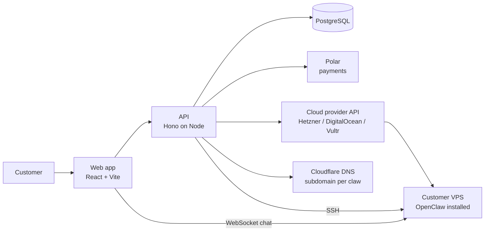

# HostClaw

**One-click hosting for OpenClaw agents. Pay for a plan and get your own server with OpenClaw already running.**

## What it is

HostClaw sells hosted OpenClaw servers. A customer picks a plan and pays, and the platform provisions a VPS, points a subdomain at it, installs OpenClaw and manages it from a dashboard. Nobody does any of it by hand.

HostClaw started from the open-source [ClawHost](https://github.com/bfzli/clawhost) project (MIT licensed). Credit for the original platform goes to its authors. I rebranded it, put it live as hostclaw.cloud and run it on my own server.

## Demo

- Live: **[hostclaw.cloud](https://hostclaw.cloud)**
- Demo video coming soon.

## How it works

- The customer pays through Polar, and the API creates a VPS with the chosen cloud provider.
- The API adds a Cloudflare subdomain for the new server and installs OpenClaw on it.
- After that the API manages each server over SSH: logs, config files, versions, channels and skills.
- Login is by one-time code, and transactional email goes through Resend.
- It is a pnpm monorepo with a Hono API, a React web app, an Expo mobile app and an Electron desktop app.

## Interesting problems

- **Running it in production.** HostClaw runs in Docker behind Traefik on my own VPS, next to my other services, so every change is planned with the shared database in mind.
- **Web code is also the desktop app.** The desktop build compiles the web app's source with the API client swapped for an IPC shim, so one web change can break two apps.
- **A rename that touches several places.** Moving from the ClawHost name to HostClaw means the domain is set in the API, the web chat client, the desktop app and the mobile app. They all have to agree, or chat with a customer's server fails.

## Stack

| Layer | Tech |
| --- | --- |
| Web | React, Vite, Tailwind CSS, TanStack Query, xterm.js |
| API | Node, TypeScript, Hono, Drizzle ORM |
| Data | PostgreSQL |
| Auth | Firebase (one-time code login) |
| Payments / email | Polar, Resend |
| Infra | Hetzner / DigitalOcean / Vultr, Cloudflare DNS, Docker, Traefik |
| Other apps | Expo (mobile), Electron (desktop) |

## Screenshots

<!-- screenshots: add assets/screenshot-1.png ... -->
Screenshots coming soon.

## My part

I did not write HostClaw from scratch. I took the open-source ClawHost project, rebranded it as HostClaw, deployed it at hostclaw.cloud and run it on my own server alongside my other services. I'm happy to talk through what I changed and how the deployment works.

## Code access

The source is private. I'm happy to walk through it in an interview.

- LinkedIn: https://www.linkedin.com/in/mdadel034
- Email: bombusbumblebees002@gmail.com
